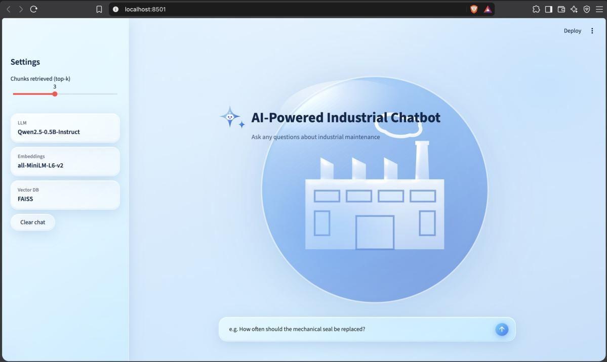

# AI-Powered Industrial Chatbot Using Hugging Face LLMs



An AI-powered industrial chatbot that answers questions about technical and maintenance documents using **Retrieval-Augmented Generation (RAG)**. It uses a Hugging Face language model, sentence embeddings, and a FAISS vector database to retrieve relevant information and generate answers with source references.


## Table of Contents

1. [Overview](#overview)
2. [Architecture](#architecture)
3. [Technologies Used](#technologies-used)
4. [Project Structure](#project-structure)
5. [Installation](#installation)
6. [Usage](#usage)
7. [How RAG Works](#how-rag-works)
8. [Relevance Safeguard](#relevance-safeguard)
9. [Adding Documents](#adding-documents)
10. [Limitations](#limitations)

## Overview

The chatbot is designed to help users find information in industrial and technical documents. The included sample document is a centrifugal pump operation and maintenance manual.

The project provides two ways to interact with the chatbot:

- **Command-line interface:** Ask questions through the terminal.
- **Web interface:** Use a browser-based interface built with Streamlit.

The chatbot displays retrieved document sections to help users understand the source of its answers.

## Architecture

```text
Industrial Documents
        |
        v
Text Extraction and Chunking
        |
        v
Sentence Embeddings
        |
        v
FAISS Vector Database
        |
        v
User Question
        |
        v
Question Embedding and Similarity Search
        |
        v
Top-k Relevant Document Chunks
        |
        v
Prompt Construction
(System Prompt + Context + Question)
        |
        v
Hugging Face Language Model
        |
        v
Generated Answer + Source References
```

## Technologies Used

| Technology | Purpose |
|---|---|
| Python | Application development |
| Hugging Face Transformers | Loading and running the language model |
| Qwen2.5-0.5B-Instruct | Text generation |
| Sentence Transformers | Creating text embeddings |
| all-MiniLM-L6-v2 | Embedding model |
| FAISS | Similarity search and vector storage |
| Streamlit | Web interface |
| PyTorch | Model inference |

## Project Structure

```text
AI_Industrial_Chatbot/
├── app.py
├── cli.py
├── ingest.py
├── rag.py
├── requirements.txt
├── README.md
├── docs/
│   └── centrifugal_pump_manual.txt
└── vector_store/
    ├── index.faiss
    └── chunks.json
```

## Installation

### 1. Clone or download the project

Open a terminal in the project directory.

### 2. Create a virtual environment

```bash
python3 -m venv .venv
```

Activate it on macOS or Linux:

```bash
source .venv/bin/activate
```

On Windows, activate it using:

```bash
.venv\Scripts\activate
```

### 3. Install dependencies

```bash
pip install -r requirements.txt
```

Internet access is required to download model files if they are not already cached.

## Usage

### 1. Build the vector database

```bash
python ingest.py
```

Run this command again whenever the source documents change.

### 2. Start the command-line chatbot

```bash
python cli.py
```

### 3. Start the web chatbot

```bash
streamlit run app.py
```

Open the local URL printed by Streamlit in your browser.

## How RAG Works

1. **Document ingestion:** The application reads the available technical documents.
2. **Chunking:** The document text is divided into smaller sections.
3. **Embedding:** Sentence Transformers converts the sections into numerical vectors.
4. **Vector storage:** FAISS stores the vectors for similarity search.
5. **Question retrieval:** The user's question is embedded and compared with stored vectors.
6. **Context construction:** The most relevant retrieved sections are added to the prompt.
7. **Answer generation:** The Hugging Face language model generates a response based on the prompt.
8. **Source display:** The interface displays the retrieved document sections and their similarity scores.

## Relevance Safeguard

The application uses a configurable retrieval-score threshold of `0.45`. If the highest retrieved score is below this threshold, the chatbot returns:

> I could not find this in the provided documents.

This is a basic safeguard. A similarity score alone cannot guarantee that an answer is factually correct or fully supported by the retrieved text.

## Adding Documents

1. Add supported text or PDF documents to the `docs/` directory.
2. Run `python ingest.py` to rebuild the vector database.
3. Restart the chatbot and test questions related to the new documents.

Check `ingest.py` for the exact document formats supported by the current implementation.

## Limitations

- Answer quality depends on the source documents and retrieval results.
- The language model may generate unsupported statements despite the relevance safeguard.
- The included knowledge base contains a sample centrifugal pump manual.
- Model loading and response generation time depend on the computer's available memory and processing resources.
- The chatbot is an informational aid and should not replace official maintenance procedures or industrial safety instructions.
